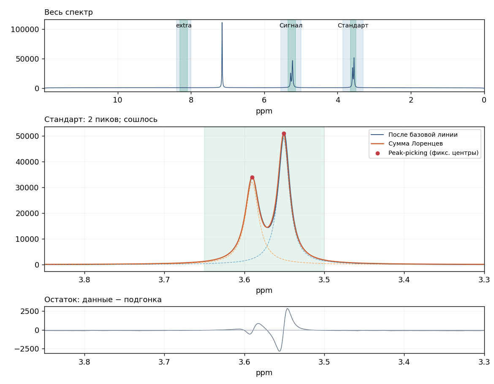

# Spintegrate — обработка одномерных спектров ЯМР

**New:** [English guide to all baseline methods and interactive region editing](docs/BASELINE_AND_REGION_GUIDE.md).

**Mouse wheel, manual phase and alignment:** [English navigation and batch-alignment guide](docs/NAVIGATION_PHASE_ALIGNMENT.md). Both whole-spectrum and per-region alignment to the first batch spectrum are available before starting a series.

Приложение развивает алгоритм из `Spintegrate.ipynb`. Поддерживаются два независимых окна: обработка сырых FID Bruker и анализ уже обработанных спектров TopSpin из `pdata`. В каждом окне можно выбрать деконволюцию Лоренцами либо прямое численное интегрирование выбранных ppm-областей, сохранить рецепт и применить его к серии.

## Запуск

Для запуска после скачивания с GitHub установите обычный Python 3.12 с Tkinter. Скачайте **Code → Download ZIP**, распакуйте архив и откройте PowerShell в папке проекта. Создайте окружение и установите библиотеки:

```powershell
python -m venv .appenv
.\.appenv\Scripts\python.exe -m pip install -r requirements.txt
.\.appenv\Scripts\python.exe spintegrate_app.py
```

После установки программу можно открывать двойным щелчком по `Start_Spintegrate.cmd`. Если Python уже установлен через Anaconda (Python 3.10 или новее с Tkinter), можно запускать приложение из Anaconda Prompt:

```powershell
python -m pip install -r requirements.txt
python spintegrate_app.py
```

`Spintegrate_GUI.ipynb` запускает то же приложение из Jupyter отдельным процессом. Ноутбук должен находиться рядом с `spintegrate_app.py` и папкой `spintegrate`. Для переноса на другой компьютер нужны эти файлы, `requirements.txt` и установленный Python с библиотеками. Локальное окружение `.appenv` переносить не нужно. Исходный исследовательский ноутбук с сохранёнными результатами остаётся локально; в репозиторий включена актуальная реализация алгоритма в `spintegrate/core.py`.

## Пример подгонки



Показаны синтетический спектр, отдельные линии Лоренца, их сумма и остаток. Зелёным обозначена область интегрирования.

## Один спектр

1. В окне raw нажмите **Открыть Bruker…** и выберите папку конкретного эксперимента, содержащую `fid` и `acqus`. Здесь поддерживаются одномерные сырые Bruker-данные; `ser` не обрабатывается. Готовые `1r` открываются в отдельном окне **Анализировать pdata…**. **Демо** загружает синтетический спектр с известными пиками.
2. На вкладке **Обработка** выберите фазу: без коррекции (реальная часть FFT), `ACME`, `peak_minima` или `abs`. P0/P1 — начальные значения автоматической коррекции. Автофаза определяется один раз по исходному спектру без дополнительного LB: сначала применяется найденная фазировка, затем аподизация и zero filling. Изменение LB, базовой линии, threshold или привязки ppm не запускает новый поиск фазы. Найденные P0/P1 видны под кнопкой **Повторить автофазировку**, которая запускает новый расчёт. При выборе другого метода фазы, изменении начальных P0/P1 или окна peak_minima определяется соответствующая новая фаза; при открытии другого спектра фазировка рассчитывается заново. В режиме `abs` всегда берётся модуль итогового комплексного спектра после FFT, отдельный выбор не нужен. Magnitude-спектр отличается по форме от чистого поглощательного Лоренца; следите за остатком подгонки.
3. Проверьте привязку ppm. По умолчанию используется шкала из метаданных каждого файла Bruker (`O1`, `SFO1`, `SW_h` для raw; `OFFSET`, `SF`, `SW_p` для pdata). Этот режим не устраняет сдвиги между экспериментами. Чтобы привести серию к одному референсу, выделите мышью окно одного характерного сигнала и нажмите **Привязать к выделенному сигналу** на вкладке **Обработка**. Программа запомнит текущую ppm этого пика и окно поиска; при необходимости задайте точное значение в поле **Референс, ppm**. Затем нажмите **Запомнить → серия** или сохраните JSON. В каждом новом спектре референс находится заново в сохранённом окне, после чего вся шкала сдвигается до целевого значения. Выбирайте окно, которое включает ожидаемый дрейф сигнала. В локальном режиме ищется сигнал после удаления прямого фона между краями окна; мнимый канал и сильный пик вне окна не подменяют референс. Также доступен прежний режим **Самый сильный пик**, использующий максимум комплексного модуля всего спектра; при смене самого сильного сигнала он может сдвинуть шкалу неверно.
4. Откройте **Аподизация / базовая линия…**. Перемещайте ползунок LB или вводите число в герцах. Сравнение с LB=0 обновляется после короткой паузы. Доступны все 62 одномерных метода pybaselines 1.2.1, сгруппированные в восемь семейств, и режим `none`. Выберите семейство и метод либо найдите его по имени. Показываются параметры выбранного алгоритма; дополнительные опции доступны через **Расширенные параметры**. Под λ есть логарифмический ползунок. Флажки над графиком показывают или скрывают исходный сигнал, базу и результат. **Отменить изменение базы** возвращает предыдущие параметры. Для `interp_pts` можно добавлять и удалять опорные позиции мышью; в JSON сохраняются только ppm, а высоты берутся заново из каждого спектра. Изменения сразу сохраняются для выбранной области и задают настройки новых областей. Чтобы перенести их на остальные сохранённые области, нажмите **Применить ко всем областям**. При выборе другой области окно показывает именно её параметры. Сохранение JSON, анализ и **Запомнить → серия** используют текущие значения, даже если предпросмотр ещё обновляется.
5. На вкладке **Области** выберите **Обработка**, выделите нужный диапазон мышью на верхнем или среднем графике и нажмите **Сохранить область**. Имя предлагается автоматически: `region_1`, `region_2` и далее, без совпадений с существующими именами. Поле имени можно отредактировать. Границы также можно вводить вручную. Области могут пересекаться и обрабатываются независимо; каждый интеграл берёт линии только из своей родительской области обработки. Выберите область в таблице для увеличенного просмотра и настройки её базовой линии.
6. Выберите **Интеграл**, укажите родительскую область обработки и меньшие или равные границы. Имя сигнала также предлагается автоматически: `signal_1`, `signal_2` и далее; его можно заменить своим. Сохраните. Можно создать несколько сигналов внутри одной области обработки. Пересечение областей интегрирования разрешено: такой пик будет входить в каждую явно заданную область.
7. На вкладке **Подгонка** задайте threshold — абсолютную высоту после локального вычитания базовой линии. В увеличенном графике показываются найденные пики и линия threshold. Нажмите **Выполнить анализ**. Смотрите компоненты, их сумму, остаток, таблицу интегралов и диагностику на вкладке **Результат**.
8. **Сохранить настройки JSON** запоминает параметры, области обработки с индивидуальными базовыми линиями и области интегрирования. **Сохранить пики и интегралы CSV…** экспортирует параметры каждой линии, таблицу с отдельным столбцом для каждой области и JSON рецепта. **Сохранить файл подгонки .spfit…** сохраняет сами рассчитанные линии и обработанный спектр для последующего просмотра. Изменение настроек делает предыдущий результат устаревшим и требует повторного анализа.

## Что изменилось в подгонке

Сохранённые области можно менять прямо на графике: выберите область в таблице и включите **Двигать границы на графике**. Потяните край для изменения размера или середину для перемещения. При перемещении области обработки её интегралы и опорные позиции интерполяции перемещаются вместе с ней; интегралы остаются внутри родительской области. **Отменить границы** / **Ctrl+Z** возвращает предыдущее расположение, **Esc** отменяет незавершённое перетаскивание. После изменения областей заново нажмите **Запомнить → серия**. Подробности и ограничения описаны в [английском руководстве](docs/BASELINE_AND_REGION_GUIDE.md).

Следующие настройки относятся к режиму **Деконволюция Лоренцами**. Альтернативный режим **Прямое интегрирование областей** описан ниже.

Модель сохранена:

```text
L(ppm) = A × w² / ((ppm − center)² + w²)
```

`center` фиксирован по peak-picking и не входит в вектор оптимизации. Начальная амплитуда — реальная высота найденного пика после вычитания базовой линии. Оптимизируются только `A` и положительная ширина `w = HWHM` в ppm. Старт ширины — `max(LB, initial FWHM) / (2 × SFO1)`, с учётом допустимых границ и цифрового разрешения. Все значения ширины в управляющих полях задаются как FWHM в герцах; в таблице модели — HWHM в ppm.

Используется ограниченная оптимизация `least_squares` с аналитическими производными, нормированием интенсивностей и логарифмом ширины. Несколько попыток с разными стартовыми ширинами уменьшают зависимость от initial guess; выбирается сошедшаяся попытка с наименьшей ошибкой. При большом числе пиков используется итерационный решатель, уменьшающий стоимость решения системы. Можно увеличить число попыток и лимит вычислений, выбрать устойчивую к выбросам ошибку `soft_l1`, сузить область или повысить threshold. Гарантировать сходимость и единственность решения для произвольного перекрывающегося спектра нельзя; такие случаи явно отмечаются.

По умолчанию ищутся положительные пики, и амплитуды ограничены `A ≥ 0`: два противоположных Лоренца в этом режиме невозможны. Для настоящих отрицательных сигналов включите **Искать и отрицательные пики**. Тогда амплитуды могут иметь любой знак. Диагностика показывает пары взаимно компенсирующихся компонент, процент компенсации, чрезмерно большие амплитуды, выход ширины на границу, обусловленность задачи и относительный RMSE (среднеквадратичный остаток, делённый на максимальную абсолютную интенсивность области).

Доля компенсации пары = `1 − Σ|L1+L2| / Σ(|L1|+|L2|)`. Большое значение означает, что крупные противоположные компоненты почти сокращаются. Предупреждение не доказывает ошибочность физических отрицательных сигналов; компоненты нужно проверить на графике.

## Интеграл

Ваше правило сохранено точно: если фиксированный центр попадает в сохранённую область интегрирования, в сумму добавляется `A × HWHM`. Границы включены. Это сумма полных вкладов выбранных линий, а не численное интегрирование обрезанного графика; хвосты за пределами области не обрезаются.

Для этой модели математическая полная площадь Лоренца равна `π × A × HWHM`. В экспортируемых интегралах множитель π отсутствует, чтобы сохранить вашу исходную шкалу. Отрицательные сигналы в signed-режиме дают отрицательный вклад.

## Анализ сохранённых спектров TopSpin: pdata

Нажмите **Анализировать pdata…** под основными кнопками raw-окна. Откроется отдельное окно с тем же редактором областей, базовыми линиями, выбором метода анализа, серией, CSV, просмотром `.spfit`, языками, цветами и экспортом рисунков. Настройки, результаты и выбранный спектр в окнах независимы. Кнопка **Анализировать raw…** возвращает к raw-окну; повторное нажатие фокусирует уже открытое окно.

**Открыть pdata…** принимает папку `эксперимент/pdata/1`, папку эксперимента или его папку `pdata`. При открытии эксперимента используется поле **Номер pdata (procno)**, по умолчанию `1`. Можно открыть другой номер обработки, например `pdata/2`; этот номер также сохраняется для серии. Нужны `1r` и `procs`; `1i` загружается, если он есть.

По умолчанию используются сохранённые данные TopSpin: масштаб `NC_proc`, реальная часть `1r`, параметры шкалы `OFFSET`, `SW_p`, `SF`, `SI`. Значения `PHC0/PHC1` сохраняются как информация о фазировке, а сама коррекция повторно не применяется — она уже учтена в `1r`. Внутренняя ppm-шкала возрастает, на графике отображается в привычном обратном направлении. По умолчанию дополнительный LB равен нулю, коррекция фазы отключена, привязка — из метаданных; для новых областей базовая линия также по умолчанию отключена.

В pdata доступны дополнительные фазировка, аподизация и zero filling. Для этих преобразований нужен настоящий мнимый канал `1i`; программа не подставляет нули вместо отсутствующей комплексной информации. Без `1i` доступны импортированная фазировка, шкала, сдвиг/референс, локальная базовая линия и оба режима анализа. Дополнительная аподизация выполняется через обратное преобразование уже обработанного комплексного спектра, а не восстанавливает исходный raw FID. Дополнительная автофаза определяется по исходному импортированному спектру и применяется перед аподизацией; изменение LB её не пересчитывает. Режим `abs` берёт модуль итогового комплексного спектра.

Raw и pdata используют одну функцию экспоненциальной аподизации: `exp(-π × LB × t)`, где LB задаётся в герцах, а время — в секундах. Для pdata направление пары FFT/IFFT определяется по исходному комплексному спектру: противоположный знак мнимого канала не должен помещать затухание в конец массива, где окно ошибочно подавляло бы почти все пики. При LB=0 без дополнительной фазировки и zero filling исходные значения сохраняются. LB в pdata — дополнительное уширение поверх уже выполненной обработки TopSpin; ранее применённая аподизация не отменяется. Для исходной линии шириной 3 Гц дополнительный LB=2 Гц даёт FWHM около 5 Гц в обоих режимах.

Обрезанные при сохранении pdata с неоднозначными `STSR/STSI/FTSIZE` пока отклоняются с объяснением: сохраните полный спектр в TopSpin или используйте raw. Это позволяет не назначить таким точкам неверную ppm-шкалу. Поддерживаются одномерные спектры.

Для серии выберите корневую папку экспериментов и нажмите **Запомнить → серия** в pdata-окне. Будут найдены только `1r/procs` нужного номера обработки, без повторной обработки raw-данных и без смешивания `pdata/1` с `pdata/2`. В CSV номером спектра остаётся номер эксперимента, а не номер папки обработки. При загрузке JSON для другого источника программа откроет соответствующее raw/pdata-окно.

## Прямое интегрирование областей

В любом из двух окон откройте вкладку **Подгонка** и в поле **Метод анализа** выберите **Прямое интегрирование областей**. Задайте области обработки и вложенные области интегрирования тем же способом, что и для Лоренцев. Если коррекция базовой линии не нужна, выберите для родительской области метод `none`.

Этот режим выполняет локальную коррекцию базовой линии, затем считает `∫ I(ppm) dppm` методом трапеций. Точные границы областей включаются с линейной интерполяцией крайних точек. Поиск пиков, threshold, начальные ширины и оптимизация не используются; соответствующие поля отключаются. Знак сохраняется: отрицательный сигнал даёт отрицательную площадь. Интервалы могут пересекаться; каждый интеграл использует только свою родительскую область обработки.

График показывает закрашенную площадь сигнала и накопленные интегралы вместо остатка подгонки. Единицы прямого интеграла — **интенсивность × ppm**. Он не равен прежней величине `Σ A × HWHM` и не нормируется автоматически к относительным интегралам TopSpin, например к стандарту `1` или `100`.

Выбранный метод, границы, базовые линии, источник и номер pdata входят в JSON и `.spfit`. **Запомнить → серия** повторяет их для каждого спектра, а CSV сохраняет отдельную числовую колонку на область. В прямом режиме одиночный экспорт сразу создаёт CSV интегралов; таблица несуществующих пиков не создаётся. Старые настройки без выбора метода продолжают использовать Лоренцев и raw.

## Серия спектров и CSV

На вкладке серии доступен флажок **Выравнивание спектров**: единый сдвиг всего спектра или независимые сдвиги областей обработки. Опорой является первый спектр найденного списка. Можно задать максимальный дрейф, минимальную корреляцию и окно глобального поиска. Выравнивание выполняется до локальной базовой линии и интегрирования; интенсивности не пересэмплируются. Качество и сдвиги видны в таблице и сохранённых файлах. Режим выбирается до запуска серии и сохраняется в JSON.

1. Подберите параметры на одном спектре и нажмите **Запомнить → серия**. Это создаёт независимый снимок рецепта: последующие изменения на вкладке одного спектра не меняют его. Загрузка JSON также запоминает рецепт для серии.
2. На вкладке **Много спектров** выберите корневую папку, путь CSV и необходимость поиска во вложенных папках. **Показать найденные спектры** позволяет проверить список.
3. Запустите анализ. В каждом спектре заново вычисляются FFT, фаза, локальные базовые линии, пики, амплитуды и ширины; общими остаются сохранённые параметры и ppm-области. Центры фиксируются отдельно для каждого спектра. Для количественного сравнения условия регистрации и масштаб интенсивности должны быть сопоставимы; автоматическая нормировка по числу накоплений или стандарту не добавлена.
4. Ошибка одного эксперимента не останавливает серию. Для несошедшейся или ошибочной области её интегралы записываются `nan`; успешно обработанные области того же спектра сохраняются. Если пиков выше threshold нет, интеграл равен нулю и выводится предупреждение. Кнопка остановки сохраняет уже обработанную часть после текущего спектра.

JSON хранит только метод и числовые параметры коррекции базовой линии для каждой области, вместе с её ppm-границами. Рассчитанная кривая туда не записывается. В обоих режимах raw/pdata и при прямом интегрировании базовая линия заново оценивается по данным каждого нового спектра, вычитается только внутри родительской области обработки, после чего интегрируется скорректированный сигнал. Метод `none` явно отключает коррекцию для данной области. После изменения параметров заново нажмите **Запомнить → серия**, чтобы обновить снимок рецепта серии.

Рецепт серии показывает выбранный режим привязки ppm и окно референса. В `.diagnostics.json` для каждого спектра записывается `reference_shift_ppm` — фактически применённый сдвиг шкалы с учётом ручного offset. Исходная и целевая ppm референса также сохраняются в метаданных файла `.spfit`. Выравнивание выполняется до локальной коррекции базовой линии и интегрирования. Общая ppm-привязка не требует изменения исходного шага сетки каждого спектра.

CSV в UTF-8 с BOM содержит `spectrum_number` (имя папки эксперимента или имя NPZ), `spectrum_id` (уникальный относительный путь) и по отдельному столбцу с именем каждой области. Под заголовками областей записаны только числовые интегралы — без строк вида `область=значение` и без префикса `integral__`. Например:

```csv
spectrum_number,spectrum_id,standard,signal
1,1.npz,740.6153857,751.3976701
2,2.npz,592.7425610,601.3311200
```

Числа используют точку; при импорте в Excel выберите разделитель **запятая** и соответствующие региональные настройки. Таблица во вкладке серии тоже показывает каждую область отдельной колонкой. Имена `spectrum_number` и `spectrum_id` зарезервированы; остальные имена областей, в том числе русские и с запятыми, поддерживаются.

Рядом автоматически сохраняются `имя.settings.json`, `имя.diagnostics.json` и папка `имя.fits`. В JSON остаются технические сведения: исходные пути, порядок обхода, статусы, предупреждения, фазы, число пиков, RMSE, ошибки и пары компенсации. `warning` требует просмотра диагностики; `error` содержит хотя бы одну ошибочную область. `ok` означает отсутствие отмеченных проблем, а не доказательство физической правильности модели. В CSV эти служебные поля не добавляются.

## Ручная проверка подгонки

После обработки серии выберите спектр в таблице и нажмите **Показать фит выбранного спектра** или дважды щёлкните по строке. В отдельном окне показываются весь спектр, увеличенная область с отдельными линиями Лоренца и их суммой, остаток, параметры линий, интегралы и предупреждения. Область обработки выбирается в списке. Кнопка **Экспорт картинки…** открывает настройки сохранения графика. Просмотр не меняет параметры во вкладке одиночного анализа.

Для каждого обработанного спектра в папке `имя.fits` автоматически создаётся файл `000001.spfit`, `000002.spfit` и т. д. Номер файла — порядок обхода; соответствие номеру эксперимента хранится в JSON и таблице. `.spfit` содержит обработанный спектр, локальные базовые линии, фиксированные центры, начальные высоты, рассчитанные амплитуды/ширины и настройки. При открытии показывается именно сохранённый результат без повторной оптимизации и без необходимости иметь исходный FID.

После перезапуска программы нажмите **Открыть результаты CSV…** и выберите CSV. Для переноса всей серии держите вместе CSV, оба JSON и папку `.fits`. Можно открыть отдельный `.spfit` кнопкой **Открыть файл подгонки .spfit…**; такой файл самодостаточен.

Поддерживается и прежний CSV с колонками `integral__имя`. В старых сериях файлы подгонок ещё не сохранялись: если исходные спектры доступны, программа повторит расчёт по рецепту той серии, а окно явно пометит результат как **ПОВТОРНЫЙ РАСЧЁТ**. Это может отличаться от исторической подгонки, если исходные данные или версии библиотек изменились. Новые CSV и файлы `.spfit` создаются при следующем анализе; существующие результаты автоматически не переписываются.

Для проверки интерфейса без экспериментальных данных есть **Создать демо-серию…**: создаются четыре синтетических `.npz` с уменьшающимися сигналами. Формат NPZ содержит `fid` (комплексный 1D-массив), `sf_mhz`, `sw_hz`, `carrier_ppm`; цифровой фильтр в нём уже считается удалённым.

В папке `examples` уже подготовлены такая серия, рецепт и пример `demo_integrals.csv`. Это синтетические данные, а не результаты обработки ваших измерений.

## Язык, цвета и рисунки для статьи

Вверху окна выберите **Русский / English**. Переключаются подписи интерфейса, легенды и оси графиков; рассчитанный фит и области сохраняются. Язык входит в JSON настроек. Пользовательские названия областей и пути не переводятся автоматически.

На вкладке **Области** выберите область интегрирования и нажмите **Цвет области…**. Цвет выбранной области меняется сразу; для новой области выбранный цвет используется при сохранении. Новые области получают разные цвета из палитры. Цвета сохраняются в JSON и новых `.spfit`. Старые файлы без цветов загружаются с автоматической палитрой. В окне просмотра `.spfit` также можно выбрать область в списке рядом с кнопкой цвета и изменить её оформление для текущего просмотра и экспорта.

**Экспорт картинки…** доступен под основными кнопками одиночного анализа после подгонки и в окне просмотра сохранённого фита. Можно выбрать:

- PNG или TIFF с DPI от 72 до 2400 (например, 150 / 300 / 600 / 1200); TIFF сохраняется со сжатием без потерь.
- SVG для векторного рисунка: размер задаётся в миллиметрах, DPI для векторных линий не применяется.
- Точную ширину и высоту в миллиметрах; для PNG/TIFF окно показывает будущий размер в пикселях.
- Язык рисунка независимо от языка интерфейса: например, оставить программу на русском и экспортировать подписи на английском.
- Весь спектр + область + остаток, область + остаток или только область. В режиме прямого интегрирования вместо остатка показывается накопленный интеграл.
- Показ пользовательских названий областей и собственный заголовок. По умолчанию пользовательские названия скрыты, чтобы русские имена областей не попадали в английский рисунок.

Параметры экспорта запоминаются после успешного сохранения и входят в JSON настроек. График экспортируется отдельно, поэтому размер, DPI, язык и цвет не меняют численные результаты анализа. При выборе чрезмерно большого растрового рисунка программа предложит уменьшить размер или DPI.

[Пример английского рисунка с выбранным цветом интегрирования](docs/images/article_english.png).

## Проверка и документация библиотек

После `python -m pip install -r requirements-test.txt` тесты запускаются командой `python -m pytest tests`. Они охватывают фиксированные центры, начальные амплитуды, ширины и интегралы, режимы фазы/abs, ppm-шкалу и физическое LB, базовые линии, отрицательные пики, диагностику компенсации, несходимость, многопиковую подгонку, сохранение рецепта, чтение синтетических файлов Bruker, пакетную обработку с ошибками, точное сохранение/восстановление подгонок, перенос файлов, числовой CSV и совместимость с прежним экспортом. Также проверяются настоящий формат `1r/procs/1i`, сохранённые ppm/фазы/масштаб, точные границы и знак прямых интегралов, отсутствие оптимизации в прямом режиме, английские подписи, цвета, PNG с точными DPI/размерами, TIFF и SVG. `python tests/gui_smoke.py`, `python tests/presentation_gui_smoke.py` и `python tests/pdata_gui_smoke.py` проверяют интерфейс в скрытых окнах. Проверки выполнены на синтетических данных.

Дополнительно проверяются сохранение фазировки при изменении LB и zero filling, порядок фазировка → аподизация для ненулевой P1, независимая фазировка спектров в серии и совместимость старых настроек abs. `python tests/phase_naming_gui_smoke.py` проверяет общий расчёт фазы в основном окне и предпросмотре аподизации, кнопку повторной автофазировки, автоматические имена и ручное переименование областей.

`tests/test_baseline_batch.py` проверяет серии настоящих файлов `1r/procs` с разными смещениями и наклонами фона для `asls`, `arpls` и `airpls`: каждая область каждого спектра получает отдельную оценку базовой линии, а JSON содержит только параметры. `python tests/baseline_batch_gui_smoke.py` проверяет передачу изменений из окна базовой линии в анализ, JSON и серию без отдельного нажатия «Применить», а также сохранение индивидуальных настроек разных областей.

`tests/test_pdata_apodization.py` сравнивает контрольный raw FID и созданные из него файлы `1r/1i/procs` с обоими знаками мнимого канала: проверяются FWHM в герцах, сохранение центров, разные LB и zero filling, большой постоянный фон и фиксированная фаза. `tests/test_reference_batch.py` проверяет выравнивание серий raw/pdata с разными исходными шкалами и частотами спектрометра. `python tests/pdata_apodization_gui_smoke.py` проверяет оба предпросмотра и перенос выделенного референса в JSON и рецепт серии.

Официальные справки: [nmrglue EM: LB в нормированных единицах](https://nmrglue.readthedocs.io/en/latest/reference/generated/nmrglue.process.proc_base.em.html), [автоматическая фаза ACME / peak_minima](https://nmrglue.readthedocs.io/en/latest/reference/generated/nmrglue.process.proc_autophase.autops.html), [pybaselines](https://pybaselines.readthedocs.io/en/stable/introduction.html).

`tests/test_baseline_catalog.py` проверяет полноту каталога и семейств, расширенные параметры, оптимизаторы и свежую коррекцию raw/pdata из JSON. `tests/test_region_editing.py` проверяет ограничения областей и отмену геометрии. `python tests/interactive_baselines_gui_smoke.py` проверяет все 62 формы параметров и реальные события мыши/клавиатуры: перенос, изменение размеров, ограничения, опорные позиции и undo в обоих окнах.

`tests/test_alignment.py`, `tests/test_manual_phase.py` и `tests/test_navigation.py` проверяют глобальные/локальные сдвиги, площади, неизменность интенсивностей, ручную фазу вокруг опоры и сохранение масштаба. `python tests/wheel_alignment_gui_smoke.py` проверяет колесо мыши, фазировку, оба выбора выравнивания перед серией, восстановление сохранённых результатов и raw/pdata.
