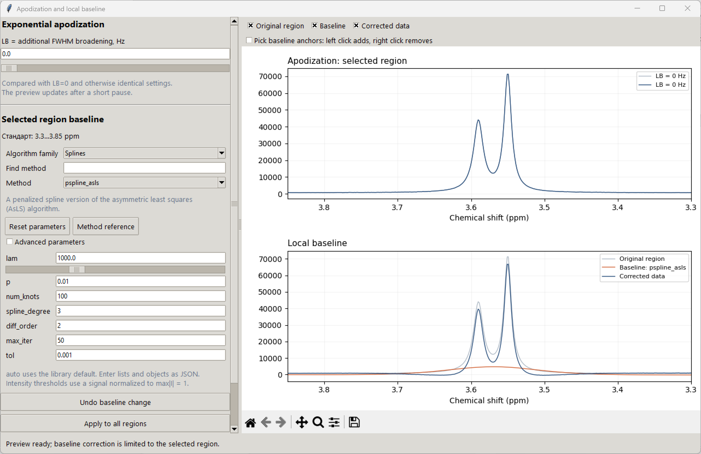
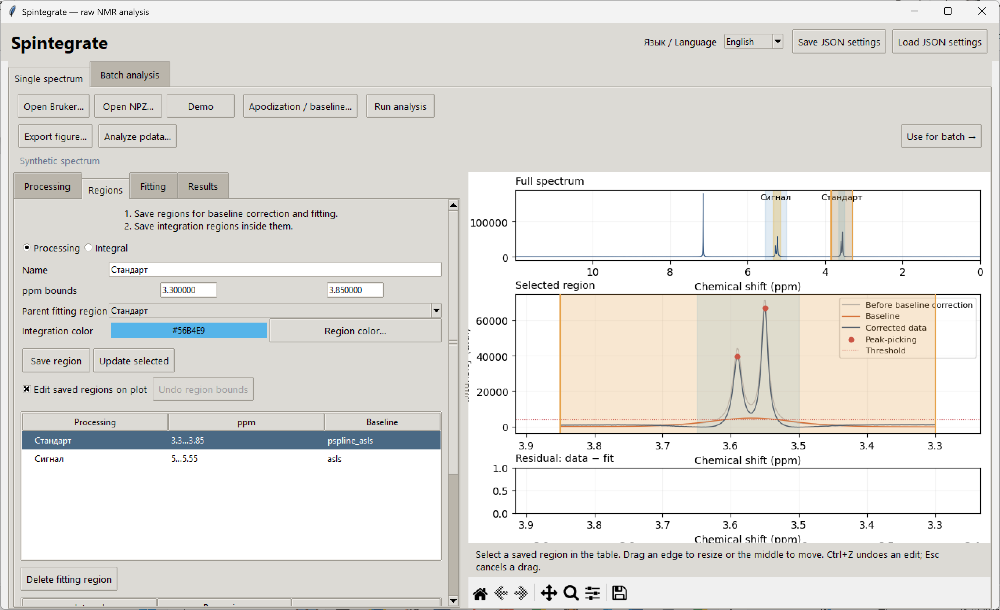

# Baseline correction and interactive region editing

Both the **raw** and **pdata** workspaces provide every 1D method exposed by the pinned **pybaselines 1.2.1** version: 62 methods, plus **none**. The families follow the [pybaselines algorithm catalogue](https://pybaselines.readthedocs.io/en/stable/api/Baseline.html).

| Family | Methods |
| --- | --- |
| Whittaker / penalized least squares | asls, iasls, airpls, arpls, drpls, iarpls, aspls, psalsa, derpsalsa, brpls, lsrpls |
| Morphological | mpls, mor, imor, mormol, amormol, rolling_ball, mwmv, tophat, mpspline, jbcd |
| Polynomial | poly, modpoly, imodpoly, penalized_poly, loess, quant_reg, goldindec |
| Splines | mixture_model, irsqr, corner_cutting, pspline_asls, pspline_iasls, pspline_airpls, pspline_arpls, pspline_drpls, pspline_iarpls, pspline_aspls, pspline_psalsa, pspline_derpsalsa, pspline_mpls, pspline_brpls, pspline_lsrpls |
| Smoothing / peak clipping | noise_median, snip, swima, ipsa, ria, peak_filling |
| Baseline / peak classification | dietrich, golotvin, std_distribution, fastchrom, cwt_br, fabc, rubberband |
| Optimizers | collab_pls, optimize_extended_range, adaptive_minmax, custom_bc |
| Other methods | interp_pts, beads |

## Choose and tune a baseline

1. Save a processing region and select it in the region table.
2. Open **Apodization / baseline**. Select an **Algorithm family** and **Method**, or type part of a method name into **Find method**. Search covers all families.
3. Adjust the displayed parameters. Only parameters accepted by the selected method are shown. The slider beneath `lam` is logarithmic: moving it changes λ over several orders of magnitude.
4. Use the checkboxes above the preview to show or hide the original region, estimated baseline and corrected signal. The preview always uses the currently selected region.
5. Changes immediately update the selected region. **Undo baseline change** restores its previous parameter settings, and **Reset parameters** loads the application defaults for that method. **Apply to all regions** explicitly copies the settings to the other saved processing regions.
6. Click **Use for batch** after tuning, or save a JSON recipe. Each spectrum and processing region gets a fresh baseline calculation.

The parameter names match the library documentation. **Method reference** opens the official page for the selected algorithm. `auto` uses the library's automatic/default setting where supported. **Advanced parameters** exposes weights, padding options, inner-method options and other less frequently used controls. Lists and objects use JSON, for example `[1, 2]` or `{"lam": 100000, "p": 0.001}` for an optimizer's `method_kwargs`.

Input intensities are normalized internally to `max(abs(I)) = 1` before baseline estimation and restored afterward. Explicit intensity thresholds such as `k` refer to that normalized signal. All plotted and integrated intensities remain in the original units.

Old recipes retain their original method and legacy values. For newly added methods, defaults follow the installed library with two stability choices: `mpls`, `mpspline` and `pspline_mpls` start at `p=0.01`, and LOESS starts with `use_threshold=true`. These choices avoid zero-weight singular systems on clean, sparsely peaked regions; the values remain editable.

Optimizer methods expose their inner `method` and `method_kwargs`. **collab_pls** is evaluated with the current spectrum as a one-trace dataset, preserving independent correction of every spectrum. It does not pool spectra or share fitted weights across a series. This differs from its usual multi-trace use described in the [pybaselines optimizer guide](https://pybaselines.readthedocs.io/en/stable/algorithms/optimizers.html).

## Pick interpolation anchors

Select **interp_pts**, or enable **Pick baseline anchors** above the preview. Left-click the lower plot to add an anchor; right-click to remove the nearest anchor. Region endpoints are included automatically. Use **Undo baseline change** to reverse an anchor edit.

JSON stores only the anchor **ppm positions**, not their intensities or a baseline curve. Heights are sampled from each new spectrum before interpolation. Anchor positions must remain inside the parent processing region. Choose an interpolation order compatible with the number of available anchors.

## Drag or resize saved regions

1. In **Regions**, select a saved processing or integration region in its table.
2. Enable **Edit saved regions on plot**.
3. Drag an edge handle to resize the selected region, or drag its middle to move it. The overview and enlarged plot both support editing. Use the enlarged plot for very narrow regions.
4. Release the mouse to save the bounds and update the analysis preview. A processing region carries its integration regions and interpolation anchors when moved. Resizing cannot exclude its integration regions or anchors. Integration regions remain within their parent processing region.
5. **Undo region bounds** or **Ctrl+Z** restores the preceding geometry; phase, LB and baseline parameters are preserved. **Esc** cancels a drag before it is committed. Structural operations such as adding, deleting or renaming a region clear geometry undo. Loading a recipe also clears it.

Turn editing off to select new regions by dragging. Zoom/pan tools retain their normal behavior. After editing, click **Use for batch** again to replace the previous frozen batch recipe.

## Verification

The numerical suite exercises every method, advanced recipes through both raw and pdata batches, independent interpolation heights, input validation, constrained region edits and undo. `python tests/interactive_baselines_gui_smoke.py` exercises all 62 parameter forms and actual Matplotlib mouse/key events in both workspaces. All checks use synthetic data.
