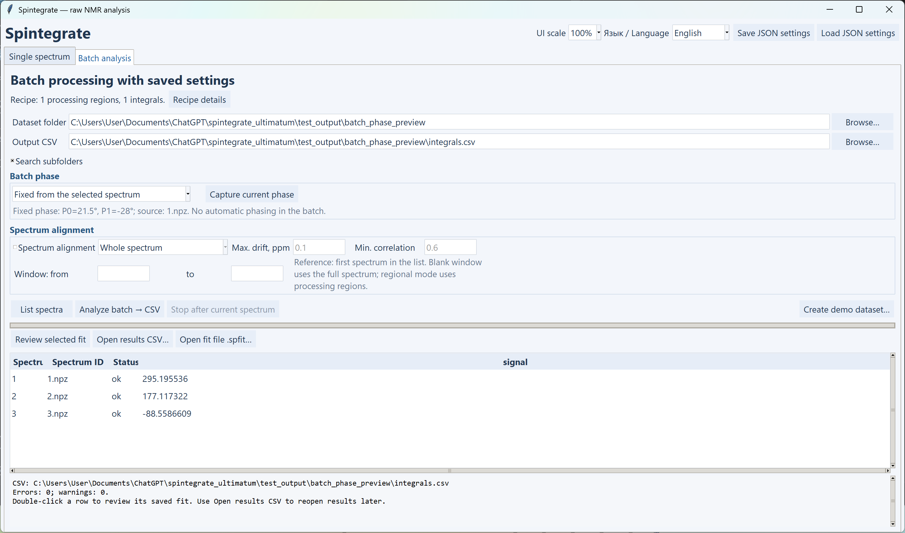

# One fixed phase for an entire batch

Use this option when a group of experiments should share one phase correction, including hyperpolarized series that are difficult to phase automatically. It is available in **raw** and **pdata**, with automatic/manual Lorentzian fitting or direct integration.

## Quick workflow / Как использовать

1. Open a representative spectrum. Select **No correction**, **ACME** or **Peak minima**, then adjust P0/P1 manually with the wheel or numeric offsets. You can choose a P1 pivot as usual.
2. In **Processing**, click **Freeze phase for batch** (**Зафиксировать фазу → серия**). This captures the complete resolved phase, including an automatic base if used, both manual offsets and the pivot conversion.
3. Click **Use for batch** (**Запомнить → серия**). In the Batch analysis tab, **Batch phase → Fixed from the selected spectrum** shows the frozen total P0/P1 and source.
4. Choose the dataset folder, alignment options and output CSV, then run the batch. The same correction is applied to every file, including the first file, without automatic phase fitting.

Alternatively, choose **Batch phase → Fixed from the selected spectrum** first, then **Capture current phase**. If no phase has been captured yet, **Use for batch** with a spectrum open captures it as part of remembering the recipe.

Коротко: сфазируйте один спектр → **Зафиксировать фазу → серия** → **Запомнить → серия** → запустите обработку папки. На вкладке серии проверьте выбранный режим **Постоянная с выбранного спектра** и значения P0/P1. Чтобы заменить фазу для новой пачки, снова нажмите **Взять текущую фазу** после настройки нового спектра.



## What is kept constant

The frozen values are the **total** correction on the original frequency grid, before additional LB/zero filling and ppm referencing/alignment. If automatic phasing produced `(P0_auto, P1_auto)` and the manual settings are `(P0_manual, P1_manual, pivot_fraction)`, the stored angles are:

```text
P0_fixed = P0_auto + P0_manual - P1_manual × pivot_fraction
P1_fixed = P1_auto + P1_manual
```

This preserves the full phase curve; the saved P0 can therefore differ from the manual-offset field displayed next to the spectrum. Changing apodization does not re-estimate the frozen phase. Alignment, local baseline correction, picking/fitting and integration still run separately on each spectrum with the saved parameters.

Freezing uses the selected spectrum's cached automatic phase, if applicable, rather than running a new automatic search. Once captured, the phase stays fixed until **Capture current phase / Freeze phase for batch** is explicitly used again. Changing the single-spectrum controls, loading another spectrum or remembering the rest of a recipe does not silently replace an already captured phase.

Fixed phasing does not automatically flip negative signals to positive. Direct integration retains their sign. For Lorentzian fits with negative components, enable **Include negative peaks** to allow signed amplitudes. Existing cancellation diagnostics remain available.

## raw and pdata

For **raw**, the total correction is applied to each spectrum's FFT before the shared apodization/zero-filling workflow.

For **pdata**, TopSpin's PHC0/PHC1 have already been applied to the imported data. Only the **additional correction made in Spintegrate** is captured and transferred. If pdata is left unchanged, the additional correction is `(0, 0)` even when the file's PHC0/PHC1 metadata are nonzero. They are never applied a second time.

Nonzero additional pdata phasing needs the real complex `1i` channel, as before. Capturing a zero additional phase can preserve real-only pdata. The rule of using a constant additional correction assumes the imported processing in that batch is appropriate for such a shared correction.

The phase profile belongs to its source type; a raw profile cannot be applied as additional pdata phase, or vice versa. **abs** has no phase curve to capture and is incompatible with fixed batch phase. Select **Independently for each spectrum** when processing in abs mode.

## Saved settings and review

JSON stores a `batch_phase` object with mode, captured flag, total P0/P1, source path for provenance and raw/pdata source type. It stores no reference trace or baseline curve. A captured profile can be loaded and applied without reopening the spectrum it came from; its source path is provenance, not an input dependency.

Batch `.settings.json`, `.diagnostics.json` and `.spfit` files retain the actual recipe and applied phases. The review window displays the fixed angles. Reconstructing a missing archive uses the recorded constant phase and does not call autophase. If alignment is enabled, its original first reference spectrum is still required, as described in the [alignment guide](NAVIGATION_PHASE_ALIGNMENT.md).

To restore the previous behavior, choose **Batch phase → Independently for each spectrum**. Automatic phase methods will then resolve each file independently and add the common manual offsets. Old recipes default to that mode. Selecting fixed mode without capturing a phase blocks batch execution instead of silently substituting zero angles.

## Verification

`tests/test_batch_phase.py` covers fixed angles with manual pivots, positive/negative signals, both FFT conventions, LB and zero filling, raw/pdata, both alignment modes, cached automatic phasing, imported TopSpin phases, JSON/archive round trips and legacy defaults. `tests/batch_phase_gui_smoke.py` covers capture buttons, initial capture through Use for batch, frozen settings, language switching, JSON-only runs and exact reconstruction of saved results. All verification data are synthetic.
