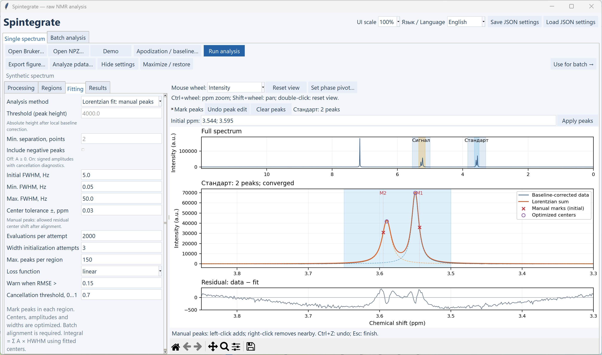

# Manual Lorentzian peaks and a sharper desktop interface

Both features work in the **raw** and **pdata** workspaces. Old recipes retain automatic peak picking with fixed centers, or direct integration, as before.

## Mark the components you want to fit

1. Load a spectrum and adjust phase, apodization and referencing. For a batch, start with the **first spectrum in the discovered batch list**, since it will define the alignment reference.
2. Save processing regions with their local baseline parameters, then save the smaller integration regions inside them.
3. In **Fitting → Analysis method**, choose **Lorentzian fit: manual peaks** (**Лоренцы: ручной выбор пиков**).
4. Select a saved processing region in **Regions**, then enable **Mark peaks** above the plot. Each processing region keeps its own marks.
5. **Left-click** adds an initial center at the clicked ppm coordinate. **Right-click** removes a mark within 14 display pixels. **Ctrl+Z** or **Undo peak edit** restores the previous mark list; **Clear peaks** removes all marks in the selected region. **Esc** leaves marking mode. Wheel navigation is still available.
6. To enter exact positions, type values such as `3.544; 3.595` into **Initial ppm** and click **Apply peaks** or press Enter. Use a decimal point. Marks must be unique and strictly inside the processing region.
7. Set **Center tolerance ±, ppm** in Fitting. The default is **0.03 ppm**. This is the residual center movement allowed after batch alignment, rather than the maximum alignment shift.
8. Click **Run analysis**. To reuse the marks and settings, click **Use for batch** or save the JSON recipe.

Disable Mark peaks to draw new regions with the mouse. Manual peak marking, saved-region dragging and phase-pivot selection are separate interaction modes. Moving a processing region translates its marks together with its integration regions; shrinking it protects existing marks. Geometry undo restores their coordinates. Peak-edit history clears when the region geometry changes.

## What the new fit optimizes

Automatic peak picking is **not called** in this mode. Every saved mark starts one Lorentzian component. Its initial amplitude is sampled afresh from the current spectrum **after that region's fresh baseline correction**. Threshold and peak separation are disabled. Amplitudes, logarithmic widths and centers are optimized with an analytic Jacobian and the existing bounded solver/restarts.

The initial HWHM is `max(LB, initial FWHM) / (2 × spectrometer frequency in MHz)`, in ppm. Width limits, robust/linear loss, signed amplitudes and cancellation diagnostics remain available. Positive amplitudes are the default. A nonpositive initial height adds a diagnostic so phase/baseline and the signed-amplitude option can be checked.

Each center is restricted to its initial mark ± the saved tolerance, clipped to the processing region and the midpoints between adjacent initial marks. The midpoint limits preserve component order and prevent center swaps. If a fitted center reaches a bound, the result is flagged for review; inspect the marks, alignment or tolerance. Strongly overlapping components may still be poorly identifiable, as reported by the existing conditioning, residual and cancellation diagnostics.

The display distinguishes **red crosses at the initial marks** from **purple circles at optimized centers**. Results and saved-fit review show fitted ppm values; diagnostics also retain initial positions, bounds and residual center shifts. The single-spectrum peaks CSV uses `center_ppm_optimized` for this method; automatic fits keep `center_ppm_fixed`.

## Batch alignment is required in manual mode

The alignment checkbox is enabled and locked on for this method. Before starting the series, choose **Whole spectrum** or **Each processing region**, and set maximum drift/minimum correlation. The same rule is enforced by the numerical batch API, including when a manually edited input JSON says `enabled: false`; the batch output recipe records the actual enabled setting.

The first spectrum in the discovered list remains the reference. Global or regional alignment runs first, then the local baseline and manual Lorentzian fit run independently on every spectrum. The optimizer can refine remaining center drift within the saved tolerance. Input intensities are not resampled or normalized by alignment. See the [alignment guide](NAVIGATION_PHASE_ALIGNMENT.md) for failure handling and quality reporting.

The integral rule is unchanged: include a component if its **optimized center** lies inside the integration interval, then sum **amplitude × HWHM**. No factor of π is added. This is the historical Spintegrate convention; the full mathematical Lorentzian area is π times that value. A center moving across an integration boundary can therefore change which components contribute.

JSON stores manual ppm marks, fit/alignment settings and baseline **parameters**, not a baseline curve, initial height or fitted component. `.spfit` archives retain the actual result for later review. Remembering a batch recipe freezes its marks; later edits in single-spectrum analysis do not change that batch snapshot.

## Display controls

The desktop now uses a lighter palette, a narrower resizable settings sidebar and a larger plotting workspace. Live plots use automatic layout with fewer repeated axis labels. On Windows, the normal launcher requests DPI awareness before creating Tk; embedded Matplotlib canvases use a native-resolution backing store that matches the space actually allocated to each plot, avoiding the high-DPI clipping seen with the pinned Matplotlib version.

* **UI scale:** 80, 90, 100, 110, 125 or 150%. Changes control fonts and live plot text in the open raw/pdata workspaces. It is saved in JSON presentation settings.
* **Hide settings / Show settings:** free the full plot width without changing the fit. You can also drag the divider to resize the sidebar.
* **Maximize / restore:** use more screen space or return to the window size. Main, preview and review windows initially fit the available display.

UI scale is independent of **Export figure → DPI**, physical dimensions and vector SVG output. Display changes preserve numerical results and the current plot navigation. Restart with `Start_Spintegrate.cmd` after updating, so Windows DPI awareness takes effect before any windows exist. A pre-existing Jupyter GUI host may already have chosen its own DPI context.

The startup order follows Microsoft's [DPI-awareness API guidance](https://learn.microsoft.com/en-us/windows/win32/api/winuser/nf-winuser-setprocessdpiawarenesscontext). The embedded-canvas workaround addresses the behavior described in the [Matplotlib project issue](https://github.com/matplotlib/matplotlib/issues/31126); it does not change exported scientific figures.

## Verification

`tests/test_manual_peaks.py` covers positive/signed peaks, linear/robust losses, fitted-center membership in integrals, bounded drift, local baselines, old JSON defaults, region geometry and raw/pdata batch alignment in both modes. `tests/manual_peaks_gui_smoke.py` exercises actual clicks, deletion/undo, numeric marks, language switching, frozen recipes, CSV, archives and reconstruction.

`tests/display_gui_smoke.py` runs with native Windows DPI awareness and checks backing-store/axes bounds, resizing, 80–150% UI scale, sidebar collapse, preview/review plots and unchanged fit arrays/export pixel dimensions. All verification data are synthetic.
