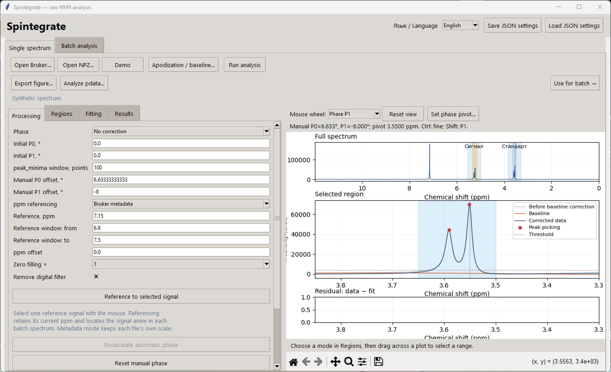
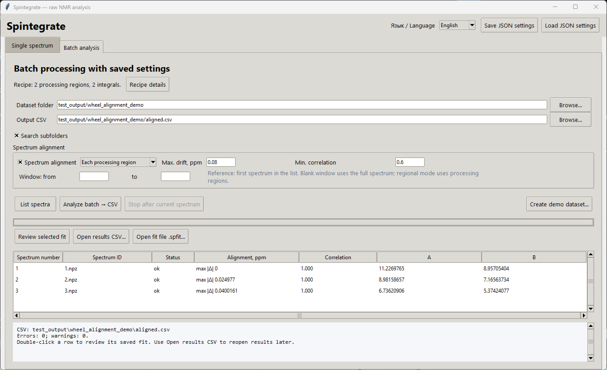

# Mouse navigation, phase tuning and batch alignment

The controls work in **raw** and **pdata**. Mouse navigation is also available in the apodization/baseline preview and the saved-fit viewer.

## Mouse-wheel navigation

Select the wheel action in the **Mouse wheel** dropdown above the plot.

| Action | Gesture |
| --- | --- |
| Enlarge/reduce displayed intensity | Wheel in **Intensity** mode |
| Zoom the ppm axis around the pointer | **Ctrl+wheel**, or wheel in **ppm zoom** mode |
| Pan horizontally | **Shift+wheel** in a navigation mode |
| Reset the current plot | Double-left-click |
| Reset all plots in that window | **Reset view** or the toolbar Home button |

Navigation changes only the view; it does not scale spectral data, change peak intensities or alter exported integrals. The ppm axis stays reversed. Zoom and pan survive phase, LB and baseline updates; loading another spectrum or selecting another processing region restores the appropriate initial view. The standard toolbar zoom and pan controls remain available.

## Tune phase with the wheel

1. Choose **No correction**, **ACME** or **Peak minima** as the base processing mode. Automatic phasing, if selected, is estimated once for the loaded spectrum.
2. Select **Phase P0** or **Phase P1** in **Mouse wheel**.
3. Roll over a spectral plot to adjust the manual offset. P0 changes by **1° per notch**, and P1 by **5° per notch**. Hold **Ctrl** for a ten-times smaller step. **Shift+wheel** selects P1. You can also use **Alt+wheel** for P0 or **Alt+Shift+wheel** for P1 while a navigation mode is selected.
4. To change the P1 pivot, click **Set phase pivot**, then click a point on the spectrum. The marked pivot and offsets appear above the plot. Changing the pivot alone preserves the existing phase curve. **Esc** cancels pivot selection.
5. **Reset manual phase** clears the offsets and restores the central pivot. It does not run automatic phasing again.

Manual offsets are added to the selected base phase **before additional apodization and zero filling**. Wheel edits do not change the ACME/peak-minima initial guesses or trigger another automatic fit. Offset values and the pivot are included in JSON recipes. Click **Use for batch** after tuning to replace the previous frozen processing recipe.

The **abs** mode ignores manual phase offsets. Additional phasing of pdata needs its complex `1i` channel; the imported TopSpin PHC values are never applied twice. Saved-fit review remains read-only, so its wheel controls only navigate the saved result.

## Choose alignment before batch analysis

In **Batch analysis**, enable **Spectrum alignment** and choose:

| Mode | Operation | Useful when |
| --- | --- | --- |
| **Whole spectrum** | Estimates one bounded ppm shift for the entire spectrum | Most peaks move together |
| **Each processing region** | Estimates a separate shift for each saved processing region | Different signal regions drift independently |

The reference is the **first spectrum in the discovered batch list**, using the existing natural experiment-number order. It is not necessarily the spectrum currently open in the single-spectrum workspace. Use **Show found spectra** to check the list. The first trace remains at zero alignment shift.

Alignment options can be changed after **Use for batch** and before **Analyze batch**. They are saved with the actual batch recipe and are locked while that batch is running. Alignment defaults to off for old recipes.

The compact recipe summary leaves room for the results table. Click **Recipe details** to expand the complete saved processing and referencing settings.

* **Max. drift, ppm** bounds the permitted shift; the default is `0.1 ppm`.
* **Min. correlation** rejects weak matches; the default is `0.6`.
* In whole-spectrum mode, an optional **Window: from/to** limits matching to stable signals. Leave both bounds blank for the full overlapping spectrum. In regional mode, each processing region provides its own window.

Matching uses normalized cross-correlation of temporary smoothed derivative features, with noise suppression and fractional-step refinement. It uses SciPy's [cross-correlation](https://docs.scipy.org/doc/scipy/reference/generated/scipy.signal.correlate.html). Matching features are used only to estimate shifts; original intensities are not normalized or replaced in the quantitative result.

### What alignment preserves

Whole-spectrum alignment shifts ppm coordinates without resampling intensities. Regional alignment independently shifts the coordinate view used for each processing region, then performs that region's **fresh baseline correction, peak picking/fitting or direct integration**. It does not splice or stretch the measured spectrum, so overlapping processing regions can still be analyzed independently. Within one region, the correction is a rigid shift rather than nonlinear peak-by-peak warping.

For regional results, the overview displays original spectral context in grey and aligned processing regions in blue. The selected region, fitted components and integrals use aligned coordinates. This avoids presenting the unprocessed gaps as if they had been warped.

### Review alignment quality

The batch table adds **Alignment, ppm** and **Correlation** columns when alignment is enabled. Whole-spectrum rows show the signed shift. Regional rows show the largest absolute region shift and the lowest correlation among successfully matched regions. Inspect the saved fit for each region's individual shift and score.

* A global matching failure produces `NaN` integrals for that spectrum and processing continues with the next one.
* A regional failure produces `NaN` only for integrals belonging to that region; successfully aligned regions remain available.
* A match at the maximum drift adds a warning for review.
* An unreadable first reference spectrum stops aligned analysis explicitly. It is never silently replaced by a later spectrum. If no reference region has usable structure, aligned analysis cannot start.

Detailed shifts, scores, reference identifiers, effective windows and failures are recorded in `.diagnostics.json` and `.spfit`. The main numerical CSV retains its spectrum identifiers and one integral column per signal. JSON contains alignment settings, not a reference curve or fitted baseline. Saved `.spfit` files can be reviewed without the original data; recalculating a missing archive requires both its input spectrum and the original first reference spectrum.

## Verification

Tests cover known positive/negative and fractional drift, independent regional drift, noisy traces, different ppm grids, quantitative area preservation, manual-phase pivots, fixed automatic phasing, saved recipes and partial alignment failures. GUI checks exercise actual wheel/click events and both batch modes in raw and pdata. All verification data are synthetic.
